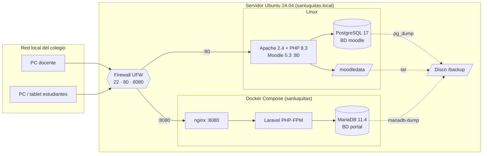

# Arquitectura

## Diagrama

## Servicios y puertos

| Servicio | Dónde | Puerto | Expuesto a la red |
|---|---|---|---|
| SSH | Linux | 22 | Sí (solo con llave) |
| Apache (Moodle) | Linux | 80 | Sí |
| nginx (Portal) | Docker | 8080 → 80 | Sí |
| PostgreSQL | Linux | 5432 | No (solo localhost) |
| PHP-FPM (Laravel) | Docker | 9000 | No (red interna) |
| MariaDB | Docker | 3306 | No (red interna) |

## Redes Docker

| Red | Tipo | Quién está |
|---|---|---|
| `frontend` | bridge | web |
| `backend` | bridge interna (sin salida) | web, app, db |

La base de datos y la app no tienen puertos publicados. Solo nginx recibe tráfico desde fuera.

## Almacenamiento

| Dato | Ubicación | Tipo |
|---|---|---|
| Código Moodle | `/var/www/moodle` | Directorio (git) |
| Archivos Moodle | `/var/moodledata` | Directorio persistente |
| BD Moodle | `/var/lib/postgresql/17` | Directorio persistente |
| BD Portal | volumen `sanluquitas_portal_db` | Volumen Docker |
| Archivos Portal | volumen `sanluquitas_portal_storage` | Volumen Docker |
| Backups | `/backup` (disco 2) | Disco separado |

## Bases de datos

| App | Motor | BD | Usuario |
|---|---|---|---|
| Moodle | PostgreSQL 17 | `moodle` | `moodleuser` |
| Portal | MariaDB 11.4 | `portal_sanluquitas` | `portal_user` |

Cada aplicación tiene su propia base de datos y su propio usuario, sin permisos sobre la otra.
